# Claude Code 團隊還需要 code review 嗎？ {#claude-code-review}

**需要。** 核心改動由 code owner 親自審，外圍改動交給 review bot，漏掉的問題再變成測試，讓 bot 越來越準。

- 產品工程約 65% 的 PR 由內部版 Claude 合併，但核心程式仍有人親自看。
- 人工審查是一塊一塊撤掉的，花了六個多月。
- 給 AI 的指示變短了，少寫禁令，多給背景。
- 信任來自 eval：事故 PR 都加進測試集。 量的時候要分 precision 和 recall，阿里巴巴的 Open Code Review 刻意拿 recall 換 precision。

@answer scope="Claude Code 單一團隊的做法 · 2026-07 訪談 · 不代表 Anthropic 全公司"
@meta locale=zh-TW style=clean
@source simon title="Simon Willison：A Fireside Chat with Cat and Thariq from the Claude Code team（2026-07-21）" url=https://simonwillison.net/2026/Jul/21/cat-and-thariq/
@source talk title="AI Engineer World's Fair 2026 原始影片" url=https://www.youtube.com/watch?v=uU5Gv2h8-9g
@source ocr title="alibaba/open-code-review README：Benchmark 與 Core Design" url=https://github.com/alibaba/open-code-review
@source aacr title="AACR-Bench 資料集（50 個 repo、200 個 PR、1,505 個標註問題）" url=https://huggingface.co/datasets/Alibaba-Aone/aacr-bench

## 一個 PR 由誰來審？ {#who-reviews}

@workflow id=review-route title="PR 審查分工"
| pr | 新的 PR | frontend |
| bot | review bot 先審 | backend |
| core | 動到核心？ | backend |
| owner | code owner 核准 | security |
| merge | 合併 | backend |
| pr > bot | 每個 PR |
| bot > core | |
| core > owner | 是 | emphasis |
| core > merge | 否 |
| owner > merge | 核准 |

@steps id=review-steps
| s1 | review bot 先審 | bot 會跑每一個 PR，很多時候大部分審查是它做的。 | review-route | bot |
| s2 | 動到核心？ | 核心指 Claude Code 本體與 system prompt 這類地方。 | review-route | core |
| s3 | code owner 核准 | 核心改動一定要 owner 核准，他對那塊品質負責。 | review-route | owner |

@metric id=merged-share label="內部版 Claude 合併的產品工程 PR" value=65 unit="%" note="Cat Wu 在訪談中的說法"

## 人工審查怎麼撤掉？ {#trust-steps}

@steps id=trust-order
| t1 | 全部人審 | 一開始每個改動都由人審。 |
| t2 | 看 bot 抓得準不準 | 按檔案範圍觀察，bot 是否抓到全部問題。 |
| t3 | 一塊一塊放手 | 某塊抓到 100% 的問題，才撤掉那塊的人工。 |
| t4 | 核心永遠有人 | 最關鍵的改動仍由 code owner 手動審。 |

@callout level=warning title="照實講的地方"
「抓到 100%」是 Cat Wu 說的撤人工條件，訪談沒講怎麼量。
整個過程花了六個多月，不是一次換掉。

## 漏掉的問題怎麼變成測試？ {#eval-loop}

@workflow id=eval-loop-flow title="事故回饋到 eval"
| incident | 發生事故 | external |
| find | 找出造成的 PR | backend |
| improve | 改 review bot | backend |
| add | PR 加進 eval | database |
| gate | 跑 eval 不退步 | security |
| incident > find | |
| find > improve | 為何沒抓到 |
| improve > add | |
| add > gate | 每次改動 | emphasis |

@steps id=eval-steps
| e1 | 找出造成的 PR | 事故檢討時回頭找那個 PR，問 review 要怎麼改才抓得到。 | eval-loop-flow | find |
| e2 | PR 加進 eval | 漏掉一次，測試集就多一個案例。 | eval-loop-flow | add |
| e3 | 跑 eval 不退步 | 之後改 bot 或換新模型，都先整套跑過，跑贏才換。 | eval-loop-flow | gate |

使用者抱怨的行為也一樣處理：排優先序，一個一個做成行為測試。Cat Wu 也承認覆蓋還沒到 100%。

## review bot 準不準，要量哪個數字？ {#bot-metrics}

| 指標 | 問的問題 | 低的時候 |
| --- | --- | --- |
| Precision | bot 報的意見裡，幾成是真的問題？ | 很吵，大家不看 {bad:失去信任} |
| Recall | 真的問題裡，bot 抓到幾成？ | 漏掉，問題流到線上 {caution:事故} |
| F1 | 兩者的調和平均，2PR /(P+R) | 單一分數，看整體 |

Cat Wu 說的「抓到 100% 才撤人工」量的是 recall。事故 PR 加進 eval，補的也是 recall。

```mermaid title="同一個模型（Claude 4.6 Opus），兩種做法（%）· 來源：OCR 官方 benchmark"
xychart-beta
  x-axis ["Precision", "Recall", "F1"]
  y-axis "%" 0 --> 40
  bar "Open Code Review" [33.9, 20.0, 25.1]
  bar "Claude Code（通用 agent）" [7.2, 28.9, 11.6]
```

| 同一個模型 | Open Code Review | Claude Code（通用 agent） |
| --- | --- | --- |
| 報出的意見 | 889 則，301 則是真的 | 5,980 則，435 則是真的 {bad:很吵} |
| 每抓到 1 個真問題 | 約 3 則意見 {good:省人力} | 約 14 則意見 |
| 抓到的真問題 | 301 / 1,505 | 435 / 1,505 {good:抓得多} |
| 平均 token | 385K {good:約 1/15} | 5,664K |
| 平均時間 | 1 分 23 秒 | 13 分 6 秒 |

算法：OCR 的 F1 = 2 × 33.9 × 20.0 ÷ (33.9 + 20.0) ≈ 25.1%。每個真問題要看的意見數 = 889 ÷ 301 ≈ 3。

@callout level=warning title="照實講的地方"
這份 benchmark（AACR-Bench）是阿里巴巴自己做的。它比的是 Claude Code 當通用 agent 做 review，不是 Claude Code 團隊內部那個 review bot。
README 寫 token 約 1/9，是整體說法；上表只取同一個模型那兩列。
F1 最高也只有約 25%，代表 bot 還取代不了人，這點和 Claude Code 團隊「核心永遠有人審」一致。

## Open Code Review 怎麼把 precision 做高？ {#ocr-design}

@workflow id=ocr-flow title="確定的事交給程式，判斷交給 agent"
| select | 選檔（程式） | security |
| bundle | 分組（程式） | security |
| rules | 配規則（程式） | security |
| agent | 每組一個 agent | cloud |
| locate | 定位與反思 | security |
| comment | 行級留言 | frontend |
| select > bundle | |
| bundle > rules | |
| rules > agent | 隔離上下文 | emphasis |
| agent > locate | 意見 |
| locate > comment | 過濾後 |

@steps id=ocr-steps
| o1 | 選檔（程式） | 程式決定哪些檔案要審、哪些過濾掉，不讓模型偷懶跳過大 PR 裡的檔案。 | ocr-flow | select |
| o2 | 分組（程式） | 相關檔案綁成一組，例如中英文兩個語系檔。每組一個 sub-agent，上下文互相隔離，可以並行。 | ocr-flow | bundle |
| o3 | 配規則（程式） | 用樣板引擎依檔案特性配規則，模型只看跟這組有關的規則。 | ocr-flow | rules |
| o4 | 每組一個 agent | agent 只做需要判斷的事：讀完整檔案、搜尋程式碼、找上下文。 | ocr-flow | agent |
| o5 | 定位與反思 | 獨立模組修正留言的行號，再檢查內容對不對，錯的不留言。 | ocr-flow | locate |

它要解的是通用 agent 做 review 的三個問題：大 PR 會挑著看、留言行號跑掉、prompt 小改品質就晃。根因是純靠自然語言，流程沒有硬約束。

@callout level=note title="跟 Claude Code 團隊的共通點"
兩邊都不是「整個丟給 AI」：Claude Code 團隊用 code owner 劃出核心範圍，OCR 用程式劃出審查範圍。
兩邊都靠固定測試集決定能不能換：一邊是事故 PR 累積成 eval，一邊是 1,505 個標註問題做成 benchmark。

## 給 AI 的指示怎麼寫？ {#prompt-style}

| 面向 | 以前 | 現在 |
| --- | --- | --- |
| 長度 | 完整版 | 最新模型縮短約八成 {good:更短} |
| 範例 | 放很多範例 | 拿掉範例，模型發揮更好 |
| 寫法 | 多寫「不要做 X」 {caution:易衝突} | 多給背景 |
| 驗證規則 | 前端改動一律驗證 | 大幅改動介面時，才在本機跑起來看 |

Thariq 說，他們以前把模型限制得太多了。禁令和使用者指示衝突時，模型會搞混。

@callout level=note title="適用範圍"
這是他們對最新模型的經驗。自己的模型適不適合變短，要用自己的測試確認。

## 回去可以檢查什麼？ {#takeaway}

- [ ] 打開你寫給 AI 的規則檔，逐句問：這一句每一次都成立嗎？
- [ ] 不是每次都成立的句子，改成寫清楚什麼情況才要做。
- [ ] 想想一個出於善意的人，會怎麼誤解這段指示。
- [ ] 如果要導入 review bot，先決定要守 precision 還是 recall，再拿自己的 PR 做一小組測試量量看。

完整逐字稿見 Simon Willison 的文章， 原始對談影片見 AI Engineer World's Fair 2026。
